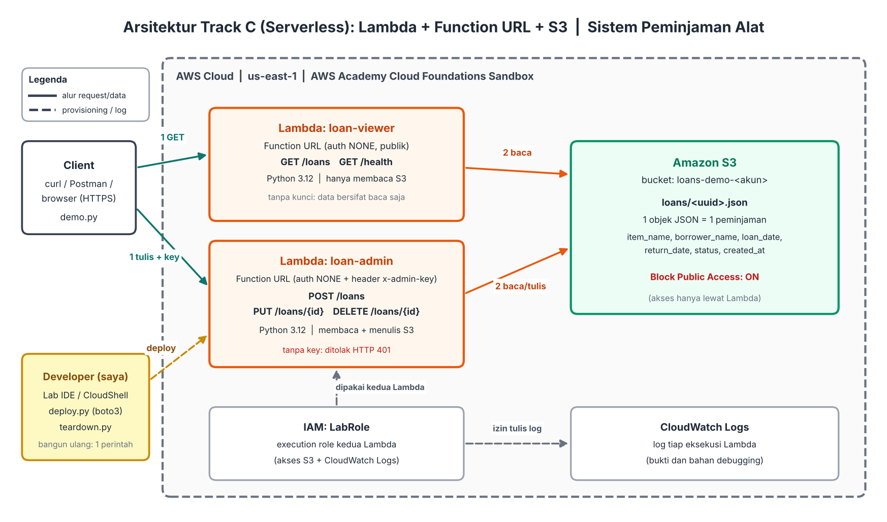

# Equipment Loans API (AWS Cloud Computing, Individual Project, Track C Serverless)

Sistem peminjaman alat sederhana berbasis **serverless**: dua fungsi **AWS Lambda** yang diakses lewat **Lambda Function URL** dan menyimpan data di **Amazon S3**.

- **Track:** C (Serverless)
- **Entitas:** `loans` (peminjaman alat), satu objek JSON di S3 per peminjaman
- **Lingkungan:** AWS Academy Cloud Foundations Sandbox (us-east-1)

## Penyesuaian dari contoh track

Contoh Track C memakai API Gateway + Lambda + DynamoDB. Di sandbox, API Gateway dan DynamoDB tidak tersedia, jadi diganti:

| Contoh track | Yang dipakai di proyek ini | Alasan |
|---|---|---|
| API Gateway | Lambda **Function URL** | endpoint HTTPS bawaan Lambda, tersedia di sandbox |
| DynamoDB | **S3** (1 objek JSON per peminjaman) | S3 tersedia; cukup untuk satu entitas dan CRUD |

## Arsitektur



## Pembagian service

Use case dipecah menjadi dua fungsi sederhana berdasarkan peran:

| Lambda | Akses | Route (lewat Function URL) |
|---|---|---|
| `loan-viewer` | hanya baca | `GET /loans`, `GET /health` |
| `loan-admin` | baca-tulis, wajib header `x-admin-key` | `POST /loans`, `PUT /loans/{id}`, `DELETE /loans/{id}`, `GET /health` |

Kode bersama untuk akses S3 ada di `lambda/loan_store.py` (dikemas ke dalam kedua fungsi).

## Data

Key objek: `loans/<loan_id>.json`. Isi: `loan_id` (UUID), `item_name`, `borrower_name`, `loan_date`, `return_date` (opsional), `status` (`BORROWED` atau `RETURNED`), `created_at`.

## Struktur repo

```
.
├── aws-evidence
├── docs/                                
│   ├── demo-script.md                   
│   ├── test-requests.md                 
│   ├── TrackC_2_architecture-diagram.png
│   └── TrackC_design-brief.pdf          
├── lambda/
│   ├── loan_store.py    
│   ├── viewer.py        
│   └── admin.py         
├── scripts/
│   ├── deploy.py        
│   ├── teardown.py     
│   └── demo.py          
├── tests/test_lambdas.py
├── .gitignore
├── README.md
└── requirements-dev.txt
``` 

## Deployment (satu perintah)

Sandbox dihapus di akhir setiap sesi, jadi seluruh infrastruktur dibuat lewat script supaya bisa dibangun ulang kapan saja.

1. Start Lab, buka **VS Code Lab IDE** (atau CloudShell), lalu ambil kode ini (`git clone`).
2. Jalankan:
   ```bash
   python3 scripts/deploy.py
   ```
   Script membuat bucket S3, dua Lambda (role **LabRole**), dua Function URL, dan izin aksesnya, lalu mencetak URL serta admin key.
3. Verifikasi dan demo:
   ```bash
   python3 scripts/demo.py
   ```
4. Bersihkan (opsional, sandbox otomatis dihapus): `python3 scripts/teardown.py`

## Tes lokal (tanpa AWS)

```bash
pip install -r requirements-dev.txt
pytest -q
```

## Keamanan

- Admin: semua operasi tulis ditolak (HTTP 401) tanpa header `x-admin-key`; key dibuat acak oleh `deploy.py`, disimpan di environment variable Lambda dan `deploy_output.json` (masuk `.gitignore`).
- S3: Block Public Access aktif; data hanya bisa diakses lewat Lambda (LabRole).
- ID di path divalidasi (format UUID) sebelum dipakai sebagai key S3.
- Tidak ada access key di kode atau repo.

## Batasan yang disadari

- Function URL bersifat publik (auth NONE); perlindungan admin berupa shared key, bukan IAM atau JWT.
- `GET /loans` membaca objek satu per satu dari S3, cukup untuk data kecil, tidak cocok untuk data besar.
- Update memakai pola baca-ubah-tulis tanpa penguncian (last-write-wins).
